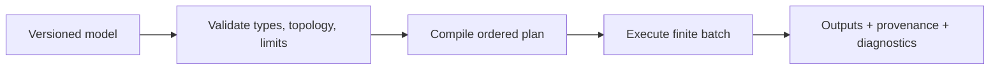

# Batch-first DSP runtime

**Status:** Proposed Stage 3 architecture; full DSP domain engine and streaming are future.
**Purpose:** Specify a batch execution path that can support the first communication slice without committing the MVP to a general DSP platform.
**Scope:** First implementation needs only verified primitives and graph shapes for conventional AM if D-02 passes. General filtering, arbitrary DSP graphs, and streaming remain future capabilities.

## Data and numerical model

**Proposed:** represent a finite signal as typed samples plus explicit `sampleRate`, sample count, time origin, unit, and numeric representation. A sample index `n` corresponds to `t0 + n/sampleRate`; no independently rounded time array is required for canonical state. Real-valued, uniformly sampled buffers suffice for the candidate AM slice; complex buffers, nonuniform samples, and multidimensional signals are future capability decisions. Typed arrays are runtime data, not portable project JSON. Parameters retain declared quantities and units; conversions must be explicit. Precision policy is an open D-01 decision, with intermediate precision and display precision kept separate.

```ts
// Illustrative contract, not production code.
type SampledSignal = {
  values: Float64Array; sampleRateHz: number; startTimeSeconds: number;
  quantity: string; unit: string; modelRevision: string;
};
type PortType = { kind: "scalar" | "real-signal"; quantity: string; unit: string };
type NodeSpec = { kind: string; version: string; inputs: Record<string, PortType>;
                  outputs: Record<string, PortType>; parameters: unknown };
```

The first candidate block roles are message source, carrier source, conventional AM modulator, and result/plot sink, but source/carrier type distinction and exact topology remain D-02. A plot sink requests an output; it should not modify samples. Nodes declare parameter constraints and input/output types. Sampling configuration is a model-level assumption shared by the lab and graph, not hidden in a chart component.

## Validation and compilation

Compilation is a deterministic transformation from a validated domain graph to an execution plan. Validate known node kinds/versions, unique IDs, port direction and quantity/unit compatibility, required inputs and multiplicity, supported topology, parameter domains, sample-rate agreement, estimated resource usage, and cycle policy. For the first slice, cycles can be rejected rather than supporting feedback. Topological ordering defines dependency order; a node runs only after its upstream inputs exist. Diagnostics refer to stable node/port IDs. Failed validation produces no partial current result. The compiler is UI-independent; moving a node on canvas cannot change the plan, while changing a connection must change the plan or produce a diagnostic.



**Parameter propagation:** a source parameter change invalidates that source and downstream computed outputs. For the first implementation, rerunning the full small graph is the simplest correct policy. Incremental dependency caching is future optimization; cache keys would need model/engine version, full inputs, sampling settings, and algorithm configuration. Never cache by visual layout or by display-rounded values.

## Stateful and streaming semantics

The batch contract starts each run from a defined initial state. Any future stateful filter or oscillator must declare reset conditions, initial state, and whether state appears in a reproducible model or run request. A cancelled or failed run cannot leak state into the next run. Future streaming processes chunks with explicit continuity, sample index, and reset boundaries; equivalence means concatenated stream output matches the specified batch reference within later-approved tolerances for the same inputs and initial state. Chunk size must not silently change model meaning. Streaming and real-time scheduling are not first-release commitments.

## Browser execution and cancellation

**Proposed:** dispatch finite runs to a dedicated browser worker through a versioned request/result envelope. The worker keeps UI interaction responsive; it is not security isolation for hostile code. Inputs are validated before and inside the worker. A cancellation token is checked between plan steps and inside operations that can cooperate; if a numerical primitive cannot stop promptly, terminate/recreate the worker as a last resort and mark the run cancelled. Resource thresholds are D-04. A non-browser runner invokes the same core for verification (NFR-003). Transfer/copy choices and any shared-memory use require measurement and browser-policy review.

## FFT and filtering conventions

Before frequency plots become authoritative, specify transform sign, normalization, frequency-bin order, one-sided versus two-sided spectra, windowing, treatment of DC/Nyquist bins, and amplitude versus power units. Tests must detect spectral leakage and aliasing rather than hiding them through plotting. Filtering is future scope; any filter primitive must document coefficients, boundary handling, phase/group delay, initial state, and numerical conditioning. No FFT or filtering library is presumed correct without independent reference checks.

## Conventional AM integration

The candidate model should explicitly define its modulation equation and amplitude convention, parameter domains, carrier/message relationship, sample rate, duration, and expected outputs. A guided lab and supported graph compile to the same engine-level model or demonstrably equivalent requests; their outputs are compared against independent analytical references. The existing university simulator is an audit candidate, not the oracle. DSB-SC, SSB, and VSB may enter the separate assignment integration path after audit; they are not automatic public-MVP nodes.

## Alternatives, open questions, and traceability

**Alternative:** implement a general streaming DSP graph first. This adds scheduling, state, buffering, and latency complexity before the first verified slice; recommend finite batch execution first. **Alternative:** hard-code lab calculations in UI; this violates NFR-003 and undermines graph equivalence. Open: D-01 precision/reference conventions, D-02 supported topology, D-04 budgets, and whether a general DSP engine is justified beyond the communication slice. Related [simulation engines](simulation-engines.md), [numerical verification](numerical-verification.md), [feasibility](../design/workspace-feasibility.md), [Stage 1 requirements](../product/requirements.md): FR-002–FR-003, FR-005–FR-006, FR-009, FR-014, NFR-001–NFR-005.
