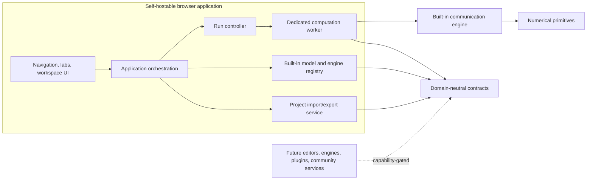
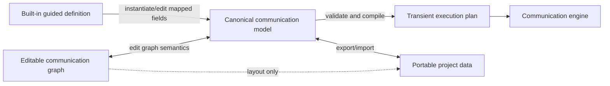

# Technical architecture overview

**Status:** Proposed Stage 3 architecture; no technical decision is Accepted.
**Purpose:** Define platform boundaries and dependency direction without enlarging the proposed first public release.
**Scope:** First implementation is one verified communication-domain vertical slice. The five long-term pillars remain Engineering Workspace, Built-in Simulations, Plugin Ecosystem, Community, and Learning; the latter two ecosystems and third-party execution are future.

## System boundaries



The **browser application** owns routing, accessible controls, plots, selection, and feedback. **Application orchestration** coordinates project revisions, validation, run lifecycle, and stale-result labeling. **Project services** parse, validate, migrate only supported formats, and export portable files; they do not rely on hosted storage. **Domain engines** own numerical behavior and engineering diagnostics. A worker is proposed for responsive browser execution, not a security sandbox. The engine must also be callable in a non-UI verification environment (NFR-003). Future hosted services may add accounts or community publication but must not be required for essential run, inspect, edit, and exchange workflows (NFR-008).

## Model and editor separation

**Proposed ownership for the first communication slice:** the communication domain package owns the versioned canonical model, parameter/quantity definitions, graph semantics, and validation rules. A built-in guided simulation definition owns its catalog text, teaching sequence, defaults, and a deterministic recipe that instantiates a supported canonical model; it does not own a separate numerical formula. Guided controls edit mapped fields in that model. The communication graph editor owns interaction and layout, while graph nodes, connections, and parameters that affect simulation are canonical model data. Users can construct a graph from an empty project; they are not limited to rearranging a built-in template. A compiler derives an execution plan from a validated model; the plan is transient and never the project's source of truth. Portable export stores the canonical model plus optional editor layout, not a compiled plan or authoritative result.



For the built-in topology, guided and graph routes refer to the same canonical fields and compile to the same plan semantics. Equivalence means matching model identity/version, parameter values, units, sampling assumptions, and results within later-approved D-01 tolerances; it does **not** claim that arbitrary user-constructed graphs equal the guided experiment. A graph with different connections is a different canonical model and must change execution or produce validation diagnostics. An editor adapter reports complete supported coverage, or a structured unsupported result with an inventory of fields it cannot preserve. Unsupported conversion leaves the source intact; an explicit fork requires a visible semantic change summary and user consent (FR-014). A circuit editor might use a schematic/netlist and a controls editor a state-space representation. No future domain must use this communication graph.

## Dependency direction

```text
UI / editor adapters / lab presentation
             ↓
application orchestration and project services
             ↓
versioned contracts ← domain engines → numerical primitives
```

Contracts define request/result envelopes, diagnostics, model metadata, and version identifiers. Engines may depend on contracts and numerical primitives but never on UI components, browser routing, or editor layout. UI code does not import engine internals. Project format contains domain model data and optional editor state, not runtime objects or executable callbacks. This is a modular monolith proposal, not a microservice plan; see [implementation boundaries](implementation-boundaries.md).

## First-release deployment

**Proposed:** static browser assets plus a locally executed built-in engine, deployable from ordinary self-hosted web serving without a proprietary managed API. No account or server project database is needed. Browser workers improve responsiveness, but fallback behavior and browser support are D-05 decisions. File import/export stays local. No claim is made that arbitrary uploaded code is safe to execute. Future community hosting, extension registries, remote engines, and managed compute are separate optional services with explicit trust boundaries.

## Cross-cutting invariants

- A run is tied to immutable model input, model/engine versions, sampling configuration, and a revision identifier. Late results cannot overwrite newer revisions.
- Validation precedes execution; input and work limits are enforced at more than the UI layer. Values for limits are D-04, not specified here.
- A reproducible project records essential model identity, version, units, and assumptions (FR-007, FR-009, NFR-002).
- Numerical references and tolerances require independent verification (D-01). The separate university AM simulator is unaudited and is not an oracle.
- The graph and conversion are proposed P0 scope but require D-02 feasibility evidence; if infeasible, product scope and priorities must be reviewed rather than quietly changed.

## Alternatives and risks

One universal graph would simplify tooling but force unrelated domains into a weak model; domain-specific editors behind shared contracts are recommended. A server-first architecture would create avoidable hosting dependency for the first release. A single UI-thread engine is simpler but risks blocking interaction; a worker is proposed while retaining a non-browser test path. These choices are recommendations, not approval of specific packages, protocols, or deployment topology.

## Open questions and traceability

Open: D-01 through D-07 in [architecture decisions](architecture-decisions.md), especially graph feasibility, browser support, and resource budgets. Related [Stage 1 requirements](../product/requirements.md): FR-001–FR-009, FR-014, NFR-001–NFR-008; future FR-010–FR-013. Related [workspace design](../design/workspace.md) and [feasibility checkpoint](../design/workspace-feasibility.md).
