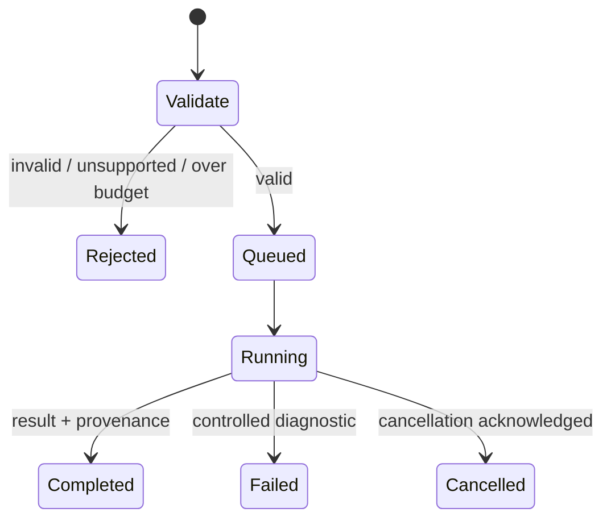

# Simulation engines

**Status:** Proposed Stage 3 contracts; API names and exact types remain subject to implementation review.
**Purpose:** Define domain-specific engine boundaries and run lifecycle independently of editor representations.
**Scope:** One built-in communication engine for the first slice. Other domain engines, external execution, and third-party registration are future.

## Contract shape

Illustrative TypeScript-style contract, **not production code or an approved API**:

```ts
type ModelRef = { domain: string; kind: string; modelVersion: string };
type RunRequest<Model> = {
  modelRef: ModelRef;
  model: Model;                 // validated domain payload, never editor layout
  runRevision: string;
  engineVersion: string;
  sampling?: SamplingMetadata; // domain-defined when applicable
  requestedOutputs: string[];
};
type Diagnostic = {
  severity: "info" | "warning" | "error";
  code: string;
  message: string;
  location?: { elementId?: string; field?: string };
};
type RunResult<Output> = {
  requestRevision: string;
  modelRef: ModelRef;
  engineVersion: string;
  outputs: Output;
  diagnostics: Diagnostic[];
  provenance: { sampling?: SamplingMetadata; assumptions: string[] };
};
interface DomainEngine<Model, Output> {
  supports(ref: ModelRef): boolean;
  validate(model: Model): Diagnostic[];
  run(request: RunRequest<Model>, cancellation: Cancellation): Promise<RunResult<Output>>;
}
```

The envelope is shared; `Model`, `Output`, and validation rules are domain-specific. A circuit engine need not accept a signal graph. Units and quantities should be explicit in domain models, not inferred from plot labels. Runtime input validation must not assume UI validation succeeded. Diagnostics have stable codes and model locations for accessible presentation; a thrown exception becomes a controlled run failure, never a successful result.

## Registry and lifecycle

The first registry is a static list of built-in engine descriptors with domain, supported model kinds/versions, output capabilities, and implementation version. Registration is internal; it is not a public plugin API. Selection is by exact supported model identity/version and capabilities, with no silent fallback to an incompatible engine. Later external engines require authenticated transport, capability negotiation, provenance, and data policy decisions.



The application assigns a model revision before dispatch. A request is immutable once queued. Editing while running marks the prior run stale; a late response is associated with its original revision and cannot become the current result. Cancellation is cooperative and best effort, with an explicit cancelled state. A resource guard checks sizes and estimated work before dispatch; the execution environment enforces elapsed work or memory limits where possible. D-04 must set actual budgets after measurement. No percent progress is fabricated when the engine cannot report it.

## Reproducibility and versions

Each result identifies model kind/version, engine implementation version, inputs, sampling configuration, units, assumptions, and requested outputs. Stable ordering and defined numerical conventions are preferred. Exact bit identity across browsers is not assumed; D-01 establishes comparison methods and tolerances after evidence. Model migrations are explicit and separate from engine execution. Results are derived artifacts, not the canonical project model.

## Editor and engine compatibility

An editor adapter declares whether it can display and edit a model version. Guided controls and graphs may both target the same communication model when verified. A conversion adapter returns either a complete model mapping with an inventory of preserved fields, or a structured unsupported outcome. It does not call the engine to mutate the source. The engine validates the resulting model before running. The workspace remains usable with future specialized editors whose representations differ.

## Alternatives, open questions, and traceability

**Alternative:** expose a graph as the universal engine request. Rejected as a recommendation because it would impose communication/DSP structure on circuits and controls. **Proposed:** shared envelope plus domain payloads. Open: exact model/version scheme (D-03), resource budgets (D-04), minimal extension boundary (D-07), and whether cancellation can interrupt all chosen numerical operations. Related [overview](overview.md), [DSP runtime](dsp-engine.md), [project format](project-format.md), [decisions](architecture-decisions.md), [Stage 1 requirements](../product/requirements.md): FR-006, FR-009, FR-014, NFR-001–NFR-003, NFR-005, NFR-007.
