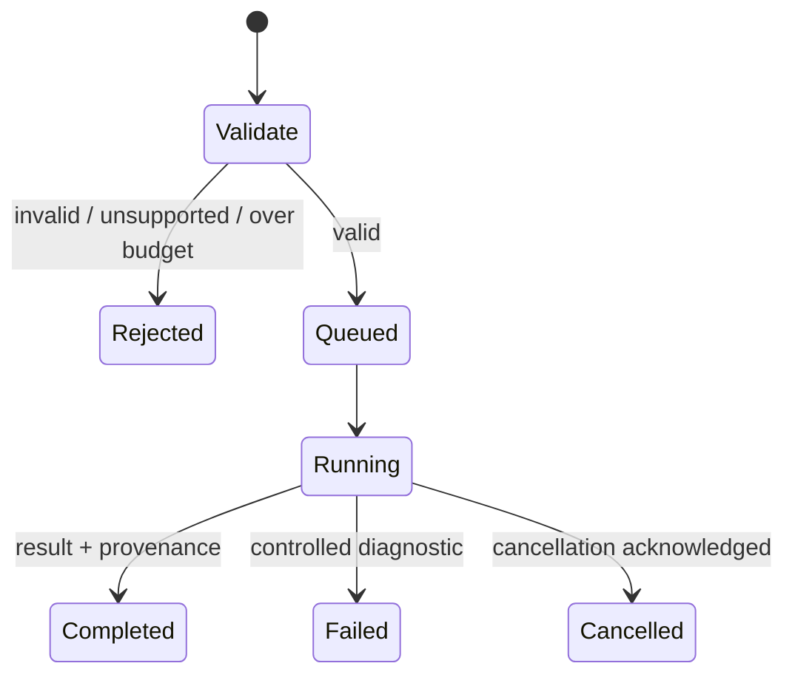

# Simulation engines

**Status:** Proposed Stage 3 contracts; API names and exact types remain subject to implementation review.
**Purpose:** Define domain-specific engine boundaries and run lifecycle independently of editor representations.
**Scope:** One built-in communication engine for the first slice. Other domain engines, external execution, and third-party registration are future.

## Contract shape

Illustrative TypeScript-style contract, **not production code or an approved API**. The exact serialization, fingerprint, and cancellation types remain open:

```ts
type ModelRef = { domain: string; kind: string; modelVersion: string };
type EngineRef = { engineId: string; engineVersion: string };
type Quantity = { value: number; unit: string }; // domain validates dimensions
type Sampling = { sampleRate: Quantity; sampleCount: number; startTime: Quantity };
type Diagnostic = {
  severity: "info" | "warning" | "error";
  code: string; message: string;
  location?: { elementId?: string; portId?: string; field?: string };
  remedy?: string;
};
type ValidatedInput<Model> = Readonly<{
  modelRef: ModelRef; model: Readonly<Model>;  // canonical domain snapshot
  sampling?: Sampling;                        // resolved, when applicable
  assumptions: readonly string[];
  inputFingerprint: string;                   // exact snapshot identity
}>;
type RunRequest<Model> = Readonly<{
  runId: string; modelRevision: string; engine: EngineRef;
  input: ValidatedInput<Model>; requestedOutputs: readonly string[];
}>;
type RunContext = {
  runId: string; modelRevision: string; modelRef: ModelRef;
  engine: EngineRef; inputFingerprint?: string; // absent if pre-run validation fails
};
type RunProvenance = RunContext & {
  inputFingerprint: string; sampling?: Sampling;
  assumptions: readonly string[];
};
type RunOutcome<Output> =
  | { status: "success"; provenance: RunProvenance;
      outputs: Output; outputUnits: Record<string, string>;
      diagnostics: readonly Diagnostic[] }
  | { status: "rejected"; context: RunContext;
      diagnostics: readonly Diagnostic[] }
  | { status: "cancelled"; context: RunContext;
      diagnostics: readonly Diagnostic[] }
  | { status: "failed"; context: RunContext;
      diagnostics: readonly Diagnostic[] };
interface DomainEngine<Model, Output> {
  supports(model: ModelRef, engine: EngineRef): boolean;
  validate(model: Model, ref: ModelRef):
    | { ok: true; input: ValidatedInput<Model> }
    | { ok: false; diagnostics: readonly Diagnostic[] };
  run(request: RunRequest<Model>, cancellation: Cancellation):
    Promise<RunOutcome<Output>>;
}
```

The envelope is shared; `Model`, `Output`, sampling applicability, and validation rules are domain-specific. A circuit engine need not accept a signal graph. Units and quantities are explicit in domain models and result descriptors, not inferred from plot labels. The immutable `ValidatedInput` is a conceptual snapshot: implementation must enforce immutability across worker or process boundaries and reject mutation or mismatched fingerprints. Fingerprint algorithm and serialization are D-03 details; the intent is stable identity of exact validated inputs, not a security signature. Runtime validation must not assume UI validation succeeded. Diagnostics have stable codes and model locations for accessible presentation. Only `success` contains outputs; validation/resource rejection, acknowledged cancellation, and unexpected execution failure cannot masquerade as successful results.

## Registry and lifecycle

The first registry is a static list of built-in engine descriptors with domain, supported model kinds/versions, output capabilities, and implementation version. Registration is internal; it is not a public plugin API. Selection is by exact supported model identity/version and capabilities, with no silent fallback to an incompatible engine. Later external engines require authenticated transport, capability negotiation, provenance, and data policy decisions.



The application assigns a model revision and unique run ID before validation; the engine descriptor supplies the implementation version. If validation fails, the application returns a rejected outcome with context and diagnostics but no input fingerprint or outputs. Validation success produces an immutable input snapshot, then the application queues a request referencing that snapshot. The engine rechecks trust-boundary and budget conditions before execution. Editing while running changes the current model revision and marks the prior result stale; a late response is associated with its original revision and cannot become the current result. Cancellation is cooperative and best effort, with an explicit cancelled outcome when acknowledged; an engine failure while cancellation is pending is still a failure. The UI owns current/stale presentation, not the numerical engine. A resource guard checks sizes and estimated work before dispatch; the execution environment enforces elapsed work or memory limits where possible. D-04 must set actual budgets after measurement. No percent progress is fabricated when the engine cannot report it.

## Reproducibility and versions

Each successful result carries provenance referencing the exact validated input snapshot by fingerprint, model/run revision, model and engine identity/version, resolved sampling, and assumptions. The request holds the canonical input values and requested outputs; the result need not duplicate the entire model, but must expose output units and enough provenance to retrieve or record that snapshot. A rejected, cancelled, or failed outcome carries model/engine identity, correlation IDs, and diagnostics, never outputs; a pre-validation rejection has no fingerprint. Stable ordering and defined numerical conventions are preferred. Exact bit identity across browsers is not assumed; D-01 establishes comparison methods and tolerances after evidence. Model migrations are explicit and separate from engine execution. Results are derived artifacts, not the canonical project model.

## Editor and engine compatibility

An editor adapter declares whether it can display and edit a model version. Guided controls and graphs may both target the same communication model when verified. A conversion adapter returns either a complete model mapping with an inventory of preserved fields, or a structured unsupported outcome. It does not call the engine to mutate the source. The engine validates the resulting model before running. The workspace remains usable with future specialized editors whose representations differ.

## Alternatives, open questions, and traceability

**Alternative:** expose a graph as the universal engine request. Rejected as a recommendation because it would impose communication/DSP structure on circuits and controls. **Proposed:** shared envelope plus domain payloads. Open: exact model/version scheme (D-03), resource budgets (D-04), minimal extension boundary (D-07), and whether cancellation can interrupt all chosen numerical operations. Related [overview](overview.md), [DSP runtime](dsp-engine.md), [project format](project-format.md), [decisions](architecture-decisions.md), [Stage 1 requirements](../product/requirements.md): FR-006, FR-009, FR-014, NFR-001–NFR-003, NFR-005, NFR-007.
