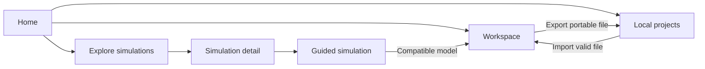

# Information architecture

**Status:** Proposed Stage 2 UX specification; routes and labels require review.  
**Purpose:** Define discoverable navigation and screen states for a guest-first, domain-neutral platform.  
**Scope:** Proposed first public release unless marked **Future**. The conventional AM vertical slice may validate these flows before release; the university assignment is separate.

## Navigation model

| Destination | Proposed route | First-release behavior | Future boundary |
| --- | --- | --- | --- |
| Home | `/` | Explain workspace, built-in simulations, and learning; offer **Explore simulations**, **Open workspace**, and **Import project** | Community and extensions can be explained as future direction in editorial content only |
| Explore simulations | `/simulations` | Catalog of actually available built-in experiments; one verified communication example is the current candidate | Additional domains appear only when working and validated |
| Simulation detail | `/simulations/{experiment-id}` | Purpose, supported model, assumptions, prerequisites, and **Launch simulation** | No links to unintegrated AM variants |
| Guided simulation | `/simulations/{experiment-id}/run` | Edit parameters, run, inspect, reset, and open compatible model in workspace | Educator-authored labs are future |
| Workspace | `/workspace` | Start supported communication model or import a portable project; limited graph editor subject to feasibility checkpoint | Specialized editors for other domains are future |
| Workspace project | `/workspace/{local-session-id}` | Edit and simulate a locally held project; identifier is a browser session locator, not a hosted project URL | Cloud project identity is future |
| Local projects | `/projects` | Explain local-file exchange; **Import project** and recent local items only if safely available | Hosted library, sync, sharing, and collaboration are future |

The public navigation exposes **Home**, **Explore simulations**, **Workspace**, and **Local projects** only when their destinations work. **Community** and **Extensions** have no disabled or fake primary-navigation entries in the first release. A clearly labeled roadmap mention may link to documentation, not to an empty product screen. Future routes and placement need separate approval.

## Home and onboarding

The home page states that OpenEE Lab is an extensible engineering platform. It identifies the currently supported domain without implying that future pillars are live. A guest can choose a simulation, create a supported workspace model, or import a project immediately. A short optional orientation explains the distinction between built-in simulations, editable projects, and portable exchange. Dismissal is optional; no signup gate or tutorial completion is required. The initial content should avoid unsupported feature screenshots or claims.

## Explore and detail

Catalog entries show domain, experiment title, short engineering purpose, supported model/version, and whether workspace editing is supported. Filters are based on populated categories; hide empty filters. If only one experiment is available, a simple list or single featured entry is enough. A detail page states model assumptions, available outputs, editable parameters, and the expected transition to the workspace. Assignment simulator modes are not catalog items until audited and integrated.

## Local projects and guest behavior

**Export** produces a portable project file; **Import** selects a local file. A recent-items list is optional and must not imply durable browser storage if the browser cannot provide it. Explain whether work is currently unsaved, locally retained, or exported. Closing or replacing unsaved work prompts for export or explicit discard. No account, proprietary service, or hosted sharing is needed for essential first-release flows.

## Responsive navigation

- **Desktop:** persistent top-level navigation, page title, and context actions; workspace may use panels.
- **Tablet:** compact top-level navigation and one primary workspace panel with secondary panels in tabs or drawers.
- **Mobile:** compact menu and single-column simulation flow. If graph editing cannot meet keyboard/touch usability at the approved support size, state its device limitation before opening it and offer inspect/export where supported. Do not show an apparently working edit action that cannot be completed.

## State specifications

| State | Required response |
| --- | --- |
| Empty catalog | Explain that no verified simulations are available and show a working path to workspace or import, if supported. Never render placeholder experiments as launchable. |
| Empty workspace/projects | Explain supported creation/import actions and how local saving works. |
| Loading or computing | Identify the operation, keep current valid results visible but marked as previous, provide cancellation when supported, and prevent duplicate conflicting actions. |
| Navigation/import error | Keep the current model intact, explain the issue in text, and give retry or a safe return path. |
| Unsupported model/version/conversion | State what is unsupported; do not mutate the current project or silently drop data. Offer an explicit fork only if its changes can be described. |
| Offline/self-hosted | Essential built-in simulation and portable project exchange should remain usable without a proprietary managed service; availability of static assets and local deployment is a later implementation decision. |

## Key design decisions and alternatives

**Proposed:** Use task-oriented top-level destinations instead of separate navigation for every pillar. Show only working destinations. **Alternative:** a pillar-by-pillar menu would expose many future-only screens and mislead guests. The `/projects` route is a local exchange surface, not a hosted library. Exact URLs are proposed UX labels, not an approved router design.

## Open questions

- Which first-release paths survive the graph feasibility checkpoint, and what is the smallest usable mobile graph interaction?
- Should recent local projects be supported, and with what truthful persistence guarantees?
- Which experiment metadata belongs on catalog cards versus detail pages?

## Related documents and traceability

[Stage 1 scope](../product/scope.md), [requirements](../product/requirements.md), [user journeys](../product/user-journeys.md), [workspace](workspace.md), [guided labs](guided-labs.md), [interaction flows](interaction-flows.md). Relevant IDs: FR-001, FR-007–FR-009, FR-014, NFR-004–NFR-006, NFR-008; future FR-010–FR-013.
