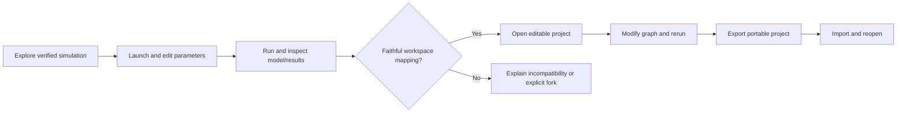

# Interaction flows

**Status:** Proposed Stage 2 interaction specification; graph-dependent flows require feasibility review.  
**Purpose:** Define observable actions, responses, and failures across the first-release journey and clearly separate future ecosystem flows.  
**Scope:** Flows 1–8 are proposed first-public-release behavior, conditional on approved scope; flows 9–10 are **Future**. The conventional AM vertical slice can test flows 2–8 before launch. Assignment integration is separate.

## Flow conventions

The current editable model, last successful result, and exported file are distinct states. A user must always be able to tell whether a result matches current inputs. Import and conversion validate before replacing work. A failed operation preserves the current project. The simulation core returns results or diagnostics independently of the UI; this document does not select an engine or project schema.

| Flow | Preconditions | User actions | System responses | Failure and recovery | Scope / IDs |
| --- | --- | --- | --- | --- | --- |
| 1. First-time guest | Site available; no account | Open home; choose Explore, Workspace, or Import | Show truthful available paths and optional orientation; no sign-in gate | If content fails, explain and provide retry; avoid dead destinations | Proposed MVP; FR-001, NFR-004, NFR-008 |
| 2. Discover and launch | At least one verified catalog item | Browse catalog; open detail; launch | Show domain, model/version, assumptions, outputs, workspace compatibility; initialize documented defaults | Unavailable or unverified item is not launchable; load failure leaves detail page with retry | Proposed MVP; FR-001, FR-009 |
| 3. Change parameters and view results | Supported simulation loaded | Edit a value; inspect validation; run; compare plots/equation | Mark prior result stale; validate; run exact current model revision; display units, metadata, result summary, and warnings | Invalid input blocks run and points to field; failure retains prior result labeled stale and editable inputs | Proposed MVP; FR-002–FR-004, FR-009, NFR-001–NFR-005 |
| 4. Open compatible simulation in workspace | Model has verified conversion mapping | Inspect model; choose Open in workspace | Carry parameters, units, sampling, assumptions, and model/version; open editable graph and indicate save state; equivalent rerun expected within approved tolerance | Unsupported mapping uses flow 7; prior simulation remains intact | Proposed MVP, feasibility dependent; FR-014, FR-009, NFR-002 |
| 5. Modify graph and rerun | Valid editable graph | Select block/port; change parameter or connection; run; inspect | Validate typed connections; record undoable edit; mark old result stale; run current revision; show plots and diagnostics | Invalid connection is rejected with reason; invalid graph remains editable; failed run preserves model and labels old result | Proposed MVP, feasibility dependent; FR-005–FR-006, NFR-004–NFR-005 |
| 6. Export, import, reopen | Supported local project or file | Export; later select file and import in fresh session/self-hosted instance | Export portable versioned file with essential model metadata; validate import before opening; restore supported model and rerunnable settings | Failed export is not reported as saved; malformed/unsupported file leaves existing work untouched and explains issue; unsaved work prompts before replacement | Proposed MVP; FR-007–FR-009, NFR-002, NFR-005–NFR-006, NFR-008 |
| 7. Incompatible conversion | Built-in model lacks faithful editable mapping | Choose Open in workspace | Explain unsupported construct or missing mapping; offer to remain in simulation | Explicit fork is offered only with itemized semantic changes and user consent; cancel preserves source; never silently discard information | Proposed MVP handling; FR-014, NFR-002 |
| 8. Invalid inputs or failed run | Lab or workspace open | Enter invalid value or run an invalid model; correct and retry | Identify field/node, reason, and remedy; keep model editable; update status and diagnostics | Resource rejection, engine failure, and cancellation have distinct messages; old results remain marked stale; retry uses current revision | Proposed MVP; FR-002, FR-005–FR-006, NFR-001, NFR-004–NFR-005 |
| 9. Plugin discovery/install | Future extension registry, trust, permission, and isolation decisions approved | Discover extension; inspect source/permissions; install | Explain compatibility, provenance, permissions, and impact before enabling | Reject untrusted/incompatible package; rollback or disable path required | **Future**; FR-012, NFR-005 |
| 10. Community publish/fork | Future hosting, identity, privacy, licensing, moderation, and attribution decisions approved | Review visibility/license; publish; another user discovers and forks | Show published version, author/attribution, fork relationship, and access setting | Failed publish leaves local source intact; unauthorized/private content is not exposed; fork conflicts are explained | **Future**; FR-010, FR-013 |

## First-release sequence

## Key design decisions and alternatives

**Proposed:** validate before transition/import, preserve source work on failure, and label results by model revision. **Alternative:** automatic conversion with best-effort omission would obscure simulation semantics and conflicts with FR-014. Explicit run is proposed for clarity; automatic recompute remains an option after resource and cancellation behavior are known. Future hosted publishing is separate from portable local exchange.

## Open questions

- What conversion subset and explicit-fork wording can be verified in the feasibility checkpoint?
- Should a running job finish against its original revision or cancel on edits?
- What import preview is useful without committing to an unapproved project schema?
- What future trust and moderation model would permit plugin and community flows?

## Related documents and traceability

[Stage 1 requirements](../product/requirements.md), [user journeys](../product/user-journeys.md), [information architecture](information-architecture.md), [workspace](workspace.md), [guided labs](guided-labs.md), [feasibility](workspace-feasibility.md). Relevant IDs are listed per flow; first-release cross-cutting NFR-003 and NFR-007–NFR-008 also apply.
