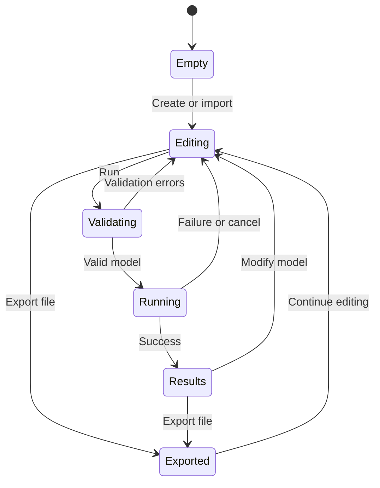

# Engineering workspace

**Status:** Proposed Stage 2 interaction specification; graph and conversion require a feasibility checkpoint.  
**Purpose:** Specify a small usable workspace now and an adaptive shell for later specialized editors.  
**Scope:** Proposed first public release for the limited communication editor; other domain editors, public plugin panels, and collaboration are **Future**.

## Workspace shell

The shell gives every supported editor a project title and save state, active model identity/version, simulation status, and clear access to the following regions. Regions may be rearranged responsively without changing model semantics.

| Region | First-release behavior | Empty/error behavior |
| --- | --- | --- |
| Project explorer | Lists the current model, supported graph elements, and result views; selection focuses the corresponding editor item | Empty project offers supported creation/import; unavailable element shows explanation |
| Main editor | Limited communication block graph with zoom, pan, select, connect, and keyboard equivalent; guided parameter view is an entry path | Incomplete graph remains editable and cannot be run until valid |
| Properties inspector | Shows selected block or model parameters, units, constraints, and validation messages | No selection shows model summary and assumptions |
| Simulation toolbar | Run, cancel when available, reset view, status, and current/previous result distinction | Disabled run states explain why via adjacent text |
| Results/plots | Time and spectrum views for the supported example, axes with units, accessible summaries | No result gives next action; failed run retains previous result labeled stale |
| Diagnostics/console | Ordered validation, warning, and simulation messages with links to affected model elements | No errors displays a quiet status; no invented success claim |

The console is a structured engineering log, not a JavaScript console or arbitrary code execution surface. UI state such as panel widths and selected tab is distinct from project model data. Whether it is persisted locally is an open technical choice; reopening a project must not depend on it.

## Three signal-editing experiences

1. **Guided parameter editing:** curated, labeled controls for a built-in experiment. Each control states unit, valid domain, current value, and reason for validation. This may be shown inside the guided simulation surface rather than the full workspace shell.
2. **Visual signal-processing graph:** supported blocks and typed ports, connections, parameters, and execution order. The first editor is communication-specific; see [feasibility](workspace-feasibility.md). Selection and connection must work without relying only on drag and drop.
3. **Model and equation inspection:** read-only view of model identity/version, assumptions, units, sampling configuration, equations, and parameter mapping. It is available before attempting conversion and after a run. Equations describe the actual supported model, not merely a generic teaching formula.

Compatible views operate on one supported simulation model or an explicitly defined, semantics-preserving mapping. A built-in simulation can open in an editable workspace only when the mapping preserves supported parameters, assumptions, units, sampling settings, and behavior within subsequently approved tolerances. Unsupported conversion fails clearly or requires an explicit fork with a change summary. Other engineering disciplines may use circuits, state-space, schematics, or other representations and need not become signal graphs. UI components do not perform numerical simulation; the core must remain independently invocable.

## Panel and interaction rules

**Proposed:** Desktop panels can be resized by pointer and keyboard, with sensible minimum readable sizes and a reset-layout action. Persist layout preferences locally if feasible, but never treat them as required project semantics. When space shrinks, replace side-by-side secondary panels with tabs/drawers; the active model and run status remain visible. Screen-reader order follows project → editor → properties → results → diagnostics, even if visual arrangement changes.

**Proposed shortcut set:** `Ctrl/Cmd+S` opens export/save, `Ctrl/Cmd+Z` undo, `Ctrl/Cmd+Shift+Z` or `Ctrl/Cmd+Y` redo, `Delete` removes a selected editable element after focus confirmation, `Escape` cancels a connection or dialog, and `?` opens shortcut help. Shortcuts must avoid browser conflicts where possible, have menu/button equivalents, and be inactive while typing in fields. Exact mapping needs usability review.

Undo/redo covers meaningful local edits: block add/remove, connection changes, and committed parameter changes. A run is not an edit; result history is not automatically undo history. Export does not clear undo. Import/replacing a project is a lifecycle boundary and must prompt for unsaved work; whether history survives import is open, but behavior must be explicit. Failed edits do not enter history.

## Responsive and accessible editing

Desktop uses a central canvas and adjacent inspector/results. Tablet uses a full-width editor with inspector and results tabs. Mobile prioritizes guided parameters and read-only model/results; full graph editing is proposed only if the feasibility checkpoint demonstrates a usable supported interaction. The graph needs a keyboard-operable element list, port selection, connect/disconnect action, and textual connection description; visual wires alone cannot carry state. Focus returns to the edited element after dialogs. Status and errors use text and accessible announcements, not color alone.

## Error handling and lifecycle

Track **unsaved edits**, **current model revision**, **last successful result revision**, and **running revision** separately. Editing while a run is active either cancels the run or lets it finish as a labeled earlier revision; choose one policy before implementation. Invalid inputs identify the field and prevent a run. Engine failures show a diagnostic identifier or readable reason if available, preserve the editable model, and never present old plots as new results. Import validates before replacing work; incompatible files leave the current project untouched. Export confirms success only after the browser completes the file action insofar as the platform can know.

## Key design decisions and alternatives

**Proposed:** A shared shell with editor-specific regions keeps navigation consistent while allowing different domain models. **Alternative:** a universal graph would simplify the visible shell but contradicts the domain-appropriate model principle. Panel persistence is convenience, not a reproducibility requirement. The limited graph remains a significant implementation risk; guided editing alone is the documented fallback option, requiring a Stage 1 scope decision rather than a silent substitution.

## Open questions

- Which graph operations and keyboard interactions pass the feasibility checkpoint?
- How should edits during an active run be handled, and what is the run cancellation contract?
- Which layout preferences are safe and useful to retain across sessions/devices?
- What subset of graph editing can be supported on small screens?

## Related documents and traceability

[Stage 1 scope](../product/scope.md), [requirements](../product/requirements.md), [interaction flows](interaction-flows.md), [design system](design-system.md), [feasibility](workspace-feasibility.md). Relevant IDs: FR-005–FR-009, FR-014, NFR-001–NFR-008; future FR-011–FR-012.
